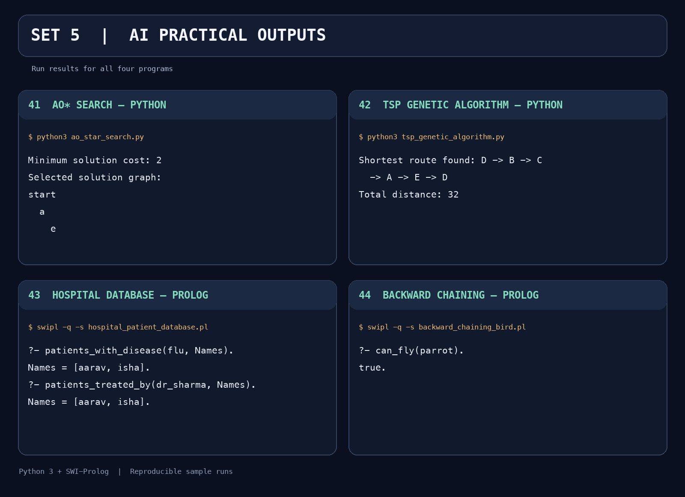

# Set 5: AI Practical Programs

All four experiment programs and their combined output image are in this folder.

## 41. AO* search on an AND-OR graph

Run: `python3 ao_star_search.py`

## 42. Travelling Salesperson using a genetic algorithm

Run: `python3 tsp_genetic_algorithm.py`. The fixed random seed makes the route reproducible.

## 43. Hospital patient database

Load `hospital_patient_database.pl` in SWI-Prolog and query:

```prolog
?- patients_with_disease(flu, Names).
?- patients_treated_by(dr_sharma, Names).
```

## 44. Backward chaining: bird flight

Load `backward_chaining_bird.pl` and query `?- can_fly(parrot).` The rule proves the query from `bird(parrot)`; the supplied `healthy(parrot)` fact is also included.

## Combined output


